# Entra ID IAM Lab

A hands-on home lab simulating real-world Identity and Access Management (IAM) workflows using Microsoft Entra ID (formerly Azure AD). Built to demonstrate practical IT support and cyber security skills including user provisioning, access control, and secure offboarding.

---

## Overview

This lab walks through the full Joiners, Movers, and Leavers (JML) lifecycle for a fictional employee (Alex Johnson) inside a personal Microsoft Entra ID tenant.

**Tools used:** Microsoft Entra ID (Free tier), Azure Portal

---

## Task 1 - Joiner: New User Provisioning

- Created user account: `alex.joiner@poushalisofficialgmail.onmicrosoft.com`
- Set display name, job title (Junior Analyst), department (IT), company (Contoso)
- Assigned **Security Reader** role
- Created security group **IT-Analysts** and added Alex as a member

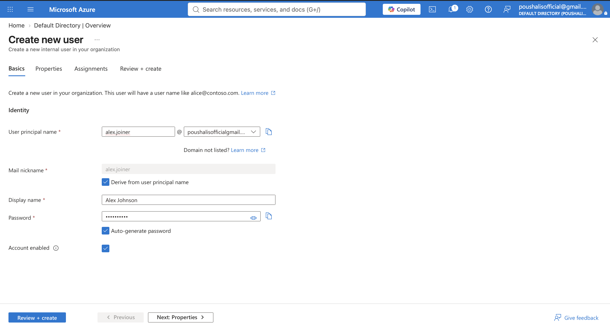
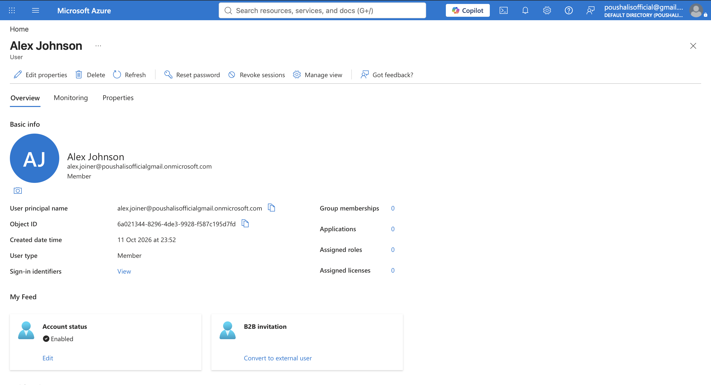
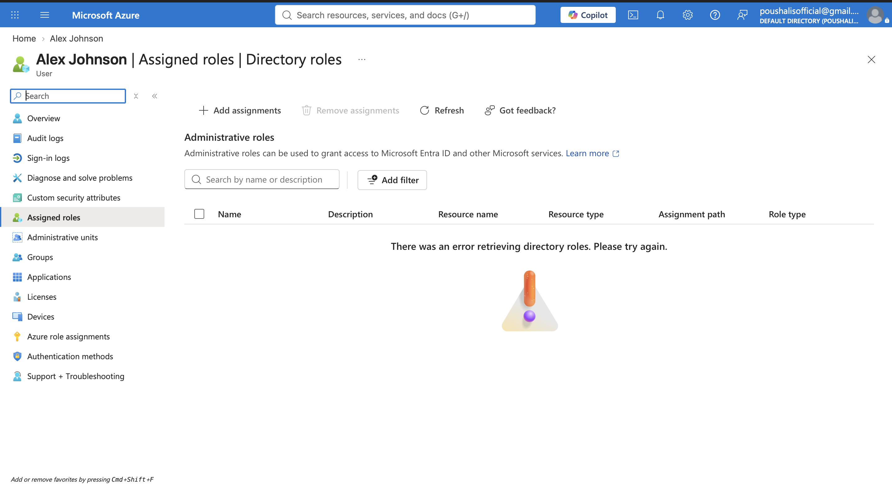
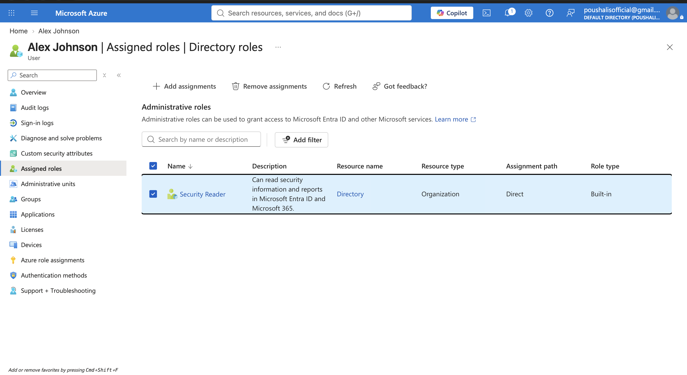
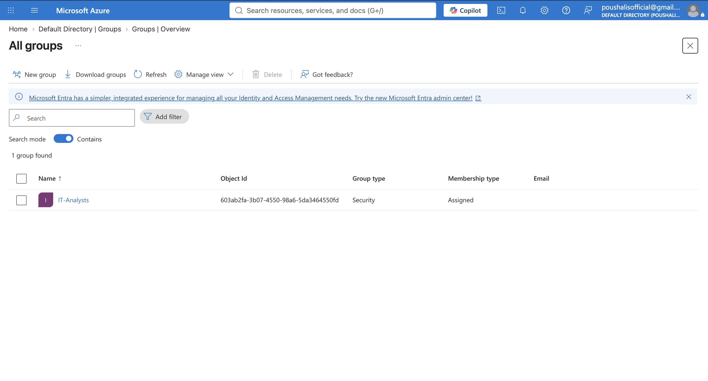
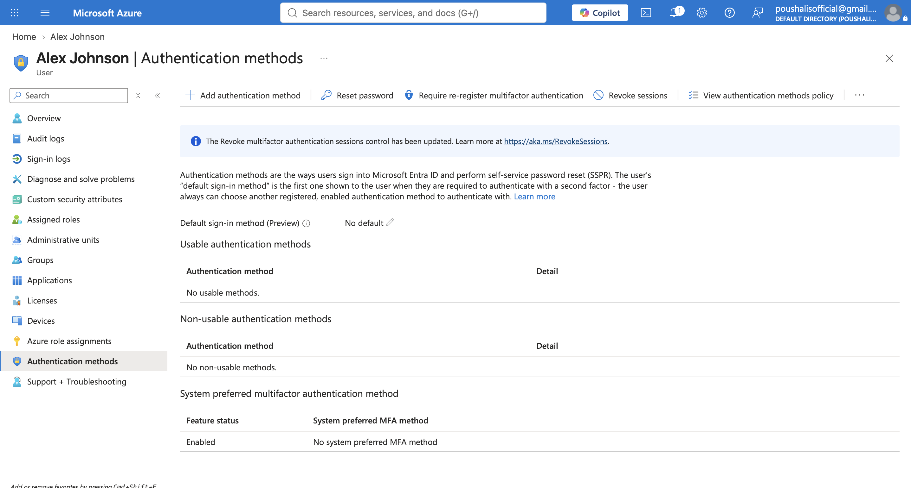

---

## Task 2 - Mover: Role and Department Change

- Updated job title to **Senior Analyst**
- Updated department to **Security Operations**
- Created new security group **SOC-Analysts**
- Added Alex to SOC-Analysts
- Removed Alex from IT-Analysts (old access revoked)

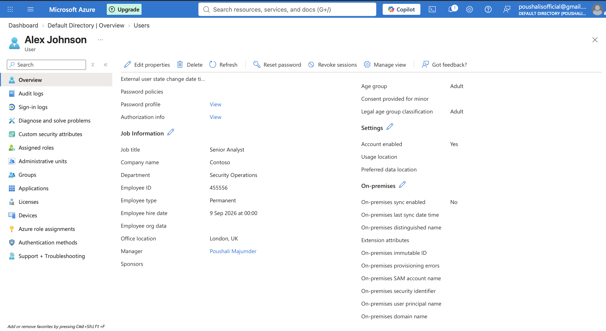
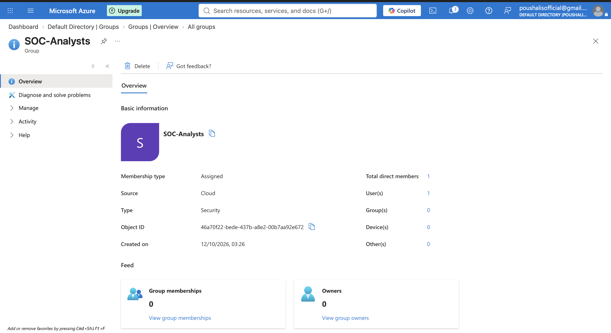
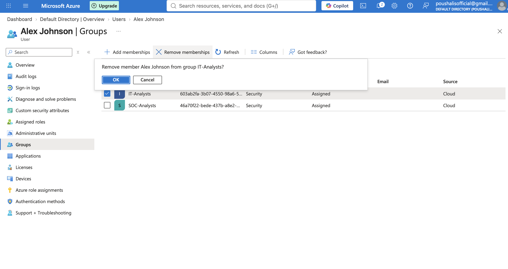

---

## Task 3 - Leaver: Secure Offboarding

- Disabled Alex's account in Entra ID
- Removed Alex from all security groups
- Account retained in directory for audit purposes

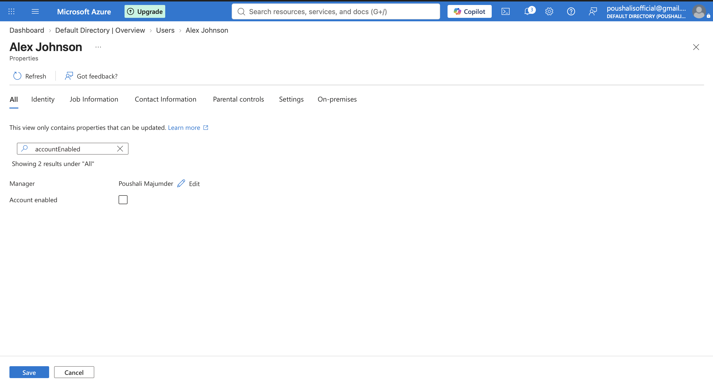
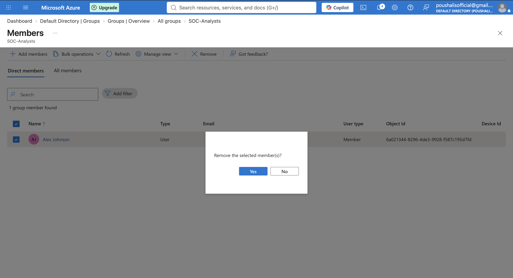

---

## Task 4 - Conditional Access (MFA Enforcement)

Navigated to Security > Conditional Access. Policy creation requires Microsoft Entra ID Premium P1, not available on the free tier.

In a production environment the policy would be configured as:
- **Users:** All users
- **Cloud apps:** All cloud apps
- **Grant:** Require multi-factor authentication

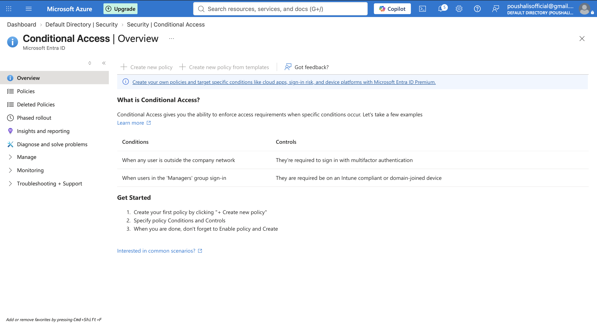

---

## Skills Demonstrated

- Microsoft Entra ID user and group management
- JML lifecycle (Joiners, Movers, Leavers)
- Role-Based Access Control (RBAC)
- Secure offboarding procedures
- Conditional Access policy design
- IT support workflows: account creation, access changes, deprovisioning

---

## Relevance to IT Support Roles

This lab directly mirrors tasks performed by first-line IT support and service desk teams:

- Creating and configuring new user accounts (Joiner)
- Updating access when employees change roles (Mover)
- Disabling accounts and revoking access on departure (Leaver)
- Enforcing security policies through Conditional Access (MFA)

---

*Built by Poushali Majumder | BSc Cyber Security, First Class Honours, UWL 2026*
